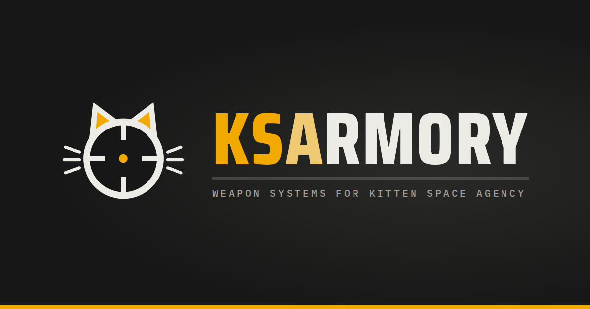
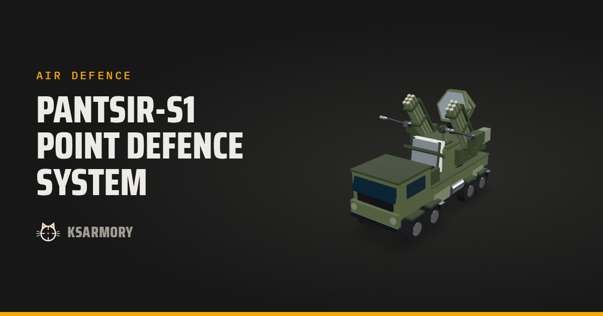
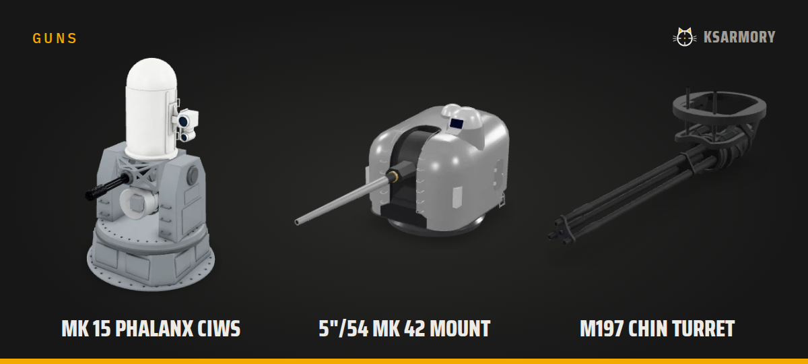
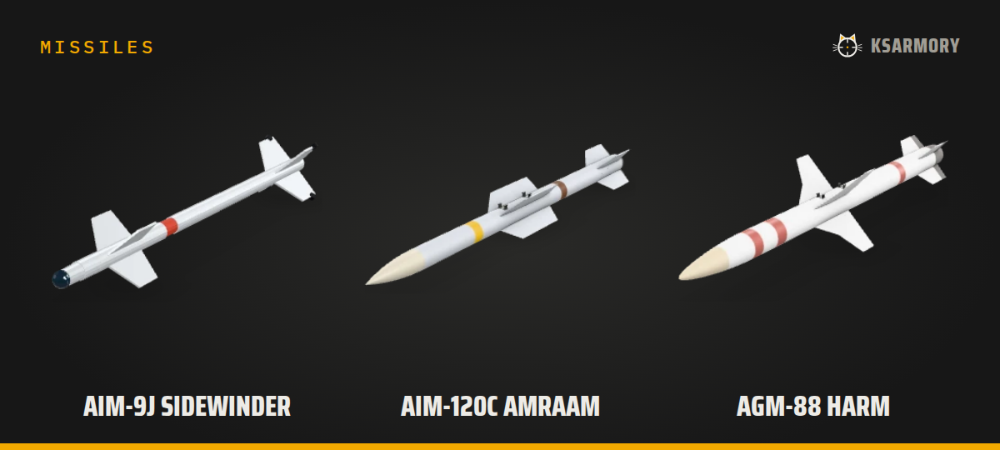
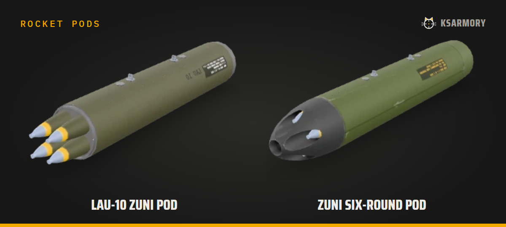
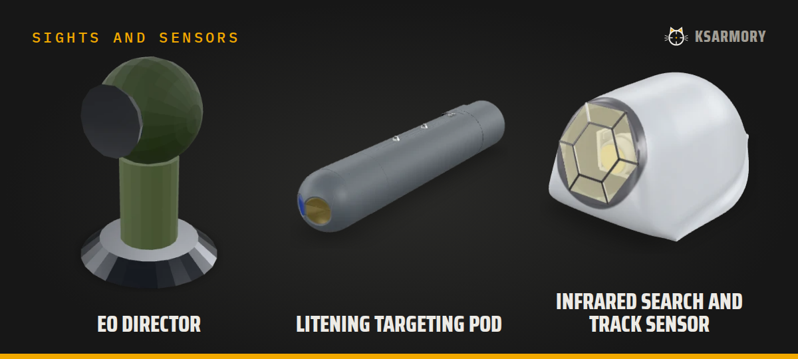
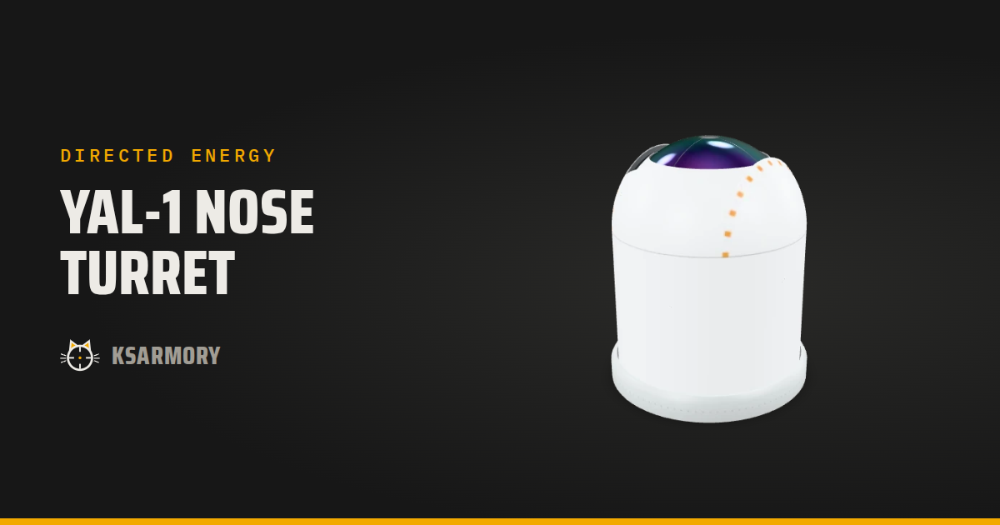
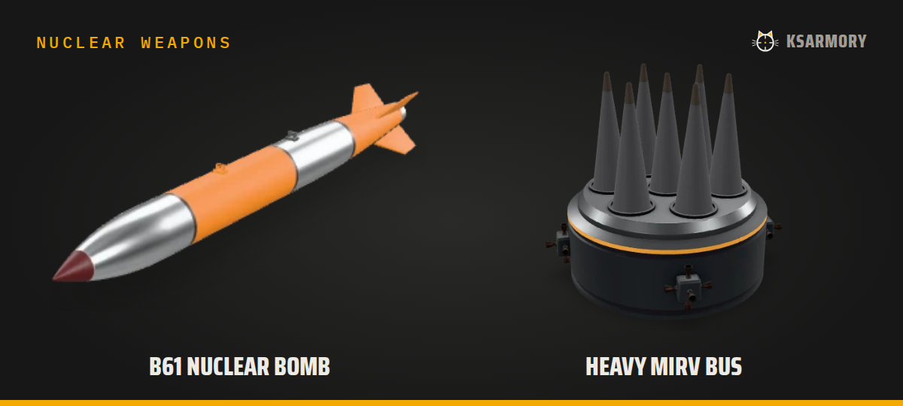
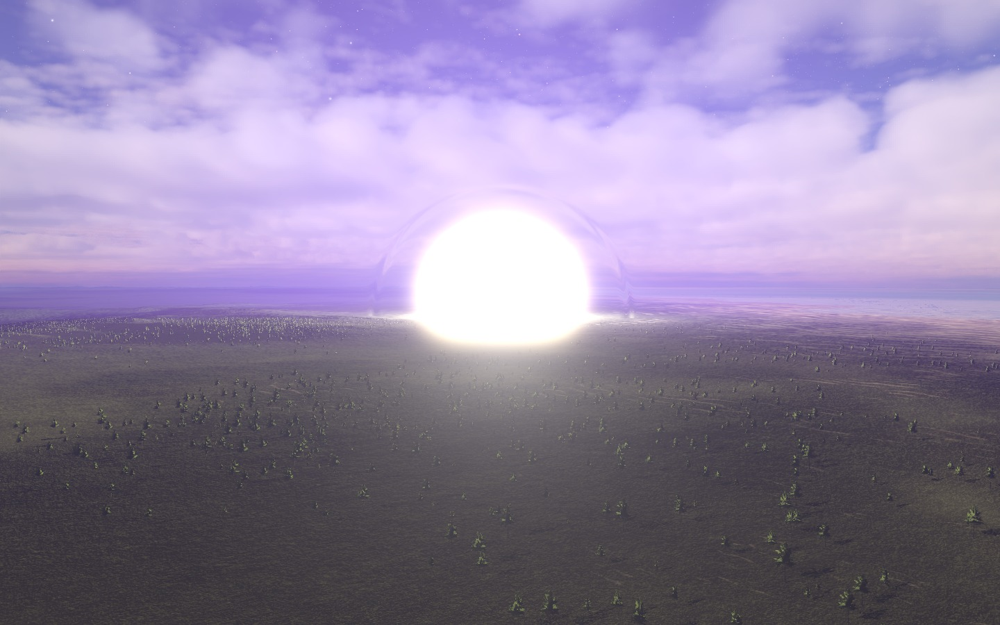

Adds working weapon systems to Kitten Space Agency. Every launcher searches, tracks, decides and shoots on its own. The mod simulates the rounds itself instead of using the vehicle physics, so guidance and fuzes run at sub-frame accuracy and cannot corrupt a save.

Every part has a page with a 3D model you can turn around on **[ksarmory.com](https://ksarmory.com)**, along with the install guide and how to use it.

### Air defence

The **Pantsir-S1** is a complete air-defence vehicle on an 8x8 chassis: a spinning search radar, twelve command-guided missiles in two pods of six, twin 30 mm cannon, and an electro-optical director on the turret roof that you can look through. The turret traverses and the pods elevate. It has its own command module, so the Pantsir alone is a craft you can build and launch.

### Guns

- **Mk 15 Phalanx CIWS**: a six-barrel 20 mm rotary cannon with its own radar, 4,500 rounds a minute. Stacks on any 3 m node.
- **5"/54 Mk 42**: a five-inch naval gun, 40 rounds a minute out to 15.7 km. Its shells burst on a timed fuze at the predicted meeting point, so they do not have to hit.
- **M197 chin turret**: a three-barrel 20 mm cannon that hangs under a nose and traverses 110 degrees either way.

### Missiles

Attach a missile to a wing, a hull or the empty Weapon Mount and it brings its own launch rail. It slides off under its own motor.

- **AIM-9J Sidewinder**: infrared-guided, 400 m to 14 km. Keeps guiding after launch on its own seeker.
- **AIM-120C AMRAAM**: radar-guided, about Mach 4, out to 105 km.
- **AGM-88 HARM**: homes on radar transmissions, out to 148 km. It can only engage a craft whose radar is switched on, and if that radar goes quiet, a missile already in the air flies on to where the signal was last heard.

### Rocket pods

The **LAU-10** carries four unguided Zuni 5-inch rockets, and the **six-round pod** carries six. No lock is needed: each press fires one rocket, and a sight draws where it will land. Models and textures by **Mallikas**, who also made the Mk 42 and the M197.

### Sights and sensors

- **EO Director**: an electro-optical sight on a mast. Watch through it in a camera window or the main view. It needs no weapon on the craft, so a hull with one director on it is an observation post.
- **Rafael LITENING pod**: the whole nose rolls about the pod's axis while the sensor ball nods inside it. It has TV and thermal modes, zooms to a 1 degree field of view, and carries a laser designator.
- **IRST**: a passive heat sensor. It sends nothing out, so it cannot be detected or homed on, and it finds targets for the sights.

### Directed energy

The **YAL-1 nose turret** is the Airborne Laser's 1.5 m telescope in a rotating nose. It stacks on a 3 m node, tracks a target and holds a 1 MW beam on whichever part it is aimed at. At 100 km a part burns through in a few seconds.

### Nuclear weapons

- **B61**: a guided nuclear bomb on the ejector rack it brings. Designate a point inside the reach ring the sight draws and it steers onto it as it falls. Yield from 0.3 kt to 340 kt.
- **Heavy MIRV Bus**: the top stage of a ballistic missile, carrying seven reentry vehicles. Click your targets on the map and the ballistic computer flies the whole rocket: ascent, guided cutoff, post-boost trim, and the release of each warhead. It picks up from wherever the vehicle already is, on the pad, mid-ascent or in orbit.

A burst behaves differently at every altitude, from a surface burst's mushroom cloud to the aurora and glowing debris of one above the atmosphere, with blast, heat, fallout and radiation that KSA's own dose gauge reads.

### Countermeasures

Two **AN/ALE-47** dispensers, one of flares and one of chaff. They attach to any surface and throw decoys to pull a missile's seeker off the craft carrying them. Fire them by hand or let them fire automatically when a missile comes for you.

### Fire control and damage

- Threats are judged by closest point of approach, so targets flying past can be engaged, not only ones flying straight at you.
- Teams with their own rules of engagement, so two sites can be on opposite sides.
- A radar can go silent, but a silent radar cannot see either.
- Rounds in the air can be shot down.
- Damage is per part: fragments, blast and impacts wear each part's health down, tanks leak from the holes, and parts catch fire.
- A paintball mode marks hits with each team's paint instead of breaking anything.

### Weapon packs

You can add weapons without writing code. A weapon pack is an ordinary KSA mod with a folder of definition files, and KSArmory's own weapons are defined the same way. Any built-in family can be switched off. See [the pack guide](https://ksarmory.com/modding/weapon-packs/).
